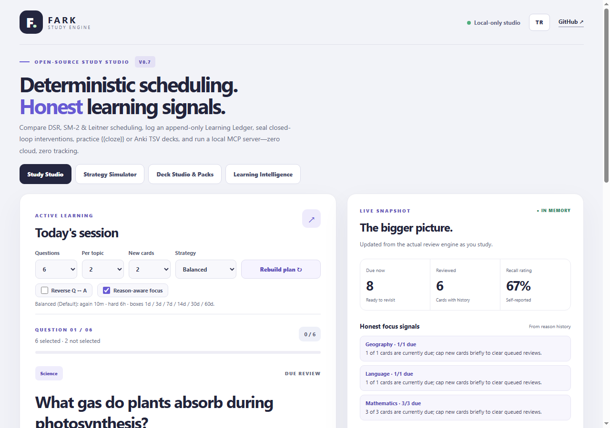

# FARK Study Engine 📚
### The thinking behind learning.

> **If every student learns differently, why should everyone have to study the same way?**

[**Türkçe**](README.tr.md) · **English**

**FARK Study Engine** is an open-source, offline-first **Learning Ledger, Cognitive Diagnosis & Closed-Loop Intervention Infrastructure**. Rather than building yet another isolated SM-2 flashcard app, FARK helps students, educators, and AI agents inspect **what a learner studied, why errors occur, which prerequisite broke first, and whether a recommended intervention actually improved recall**.

> **Architectural Manifesto & Benchmark:** Read [Why FARK Exists: Open Learning Infrastructure (v0.7.0)](docs/open-learning-architecture.md) or run `npm run demo:english` and `node scripts/benchmark-learning.mjs`.

**What ships in v0.7.0:** an append-only event ledger (`./ledger`), FSRS-style DSR memory modeling, Brier calibration & 0 TL personal parameter fitting (`./memory`, `./calibrate`), prerequisite-graph cognitive diagnosis with closed-loop control evaluation (`./diagnosis`), 13 zero-dependency MCP tools (`./mcp`), CLI `replay` / `calibrate` / `diagnose` (`./cli`), a flagship **English Mastery (A2→B2)** curriculum case study (`npm run demo:english`), and a 4-Tab Interactive Studio (`examples/web/`)—always honest that synthetic simulations and within-learner observational comparisons are not clinical RCTs.

> **Live Interactive Studio (browser-only, zero tracking):** [merttiramisu-art.github.io/fark-study-engine](https://merttiramisu-art.github.io/fark-study-engine/)



## What works today

A **dependency-free, offline-capable JavaScript module**:

- **Append-only Learning Ledger (`./ledger`):** event-sourced `fark-study-ledger` v1 log tracking `elapsedDays`, pre-review `predictedR`, optional lapse reasons, prerequisite concept DAGs (`linkConceptPrerequisites`), optional personal `params` (`initialStabilityScale`, `stabilityGainScale`), honest legacy `StudyCard[]` snapshots without fabricating timestamps, and lossless compatibility projections (`projectCardsFromLedger`).
- **Transparent DSR Memory, Replay & 0 TL Personal Calibration (`./memory`, `./calibrate`, `dsr` strategy):** FSRS-style power-law forgetting $R(t) = (1 + t/(9S))^{-1}$, mean-reverting difficulty resistant to SM-2 "ease hell" on attention slips, external CSV/JSONL/Ledger event replay across `balanced`, `sm2`, and `dsr` (`replayReviewStream`), and L2-regularized CPU parameter fitting with chronological holdout checks (`fitLearnerParameters`).
- **Prerequisite Graph Diagnosis & Closed-Loop Interventions (`./diagnosis`):** `computeConceptDynamics` separates recent recovery from old lapses, `diagnoseLearner` ranks evidence-backed signals (`fix-prerequisite`, `resolve-misconception`, `rescue-fading-memory`, `slow-down-reading`, `consolidate-backlog`), `recordIntervention` freezes target + non-target-topic baselines, and `evaluateIntervention` audits post-intervention recall, misconception, stability, and `netUpliftVsControl` deltas.
- **Study cards & Cloze prompts:** create cards with ID, topic, question, and answer—or inline `{{cloze}}` / `{{c1::answer::hint}}` / `[[blank]]` deletions (`parseClozePrompt`) and ephemeral bi-directional `reverseCardPrompt` views (`./interchange`).
- **Transparent spacing strategies (`./strategies`):** compare documented presets (`balanced`, `gentle`, `intensive`) alongside `sm2` (`1.3–2.8 EF`) and `dsr`, plus seeded 30-day (`simulateCohort`) and 360-day (`scripts/benchmark-learning.mjs`) benchmarks.
- **Reason-aware explainable sessions (`./planner`):** plan bounded round-robin study queues with explicit reason codes, optional `reasonAware: true` prioritization, and honest topic recommendations (`getStudyRecommendations`).
- **Self-reported mistake reasons & honest summaries:** optional `knowledge-gap`, `misconception`, `attention`, or `other` tags; unclassified lapses remain explicitly unknown, duplicate IDs and impossible states are rejected, and unknown accuracy stays `null`.
- **Portable formats (`./portable`, `./csv`, `./markdown`, `./interchange`):** versioned JSON decks & ledgers, RFC 4180 CSV (with opt-in formula-injection escaping), printable Markdown study sheets, Anki/Quizlet `.tsv` round-trips, `buildConceptNodesForCards`, and **5 curated original sample packs** (`starter`, `english`, `computer-science`, `biology`, `language`).
- **Zero-dependency CLI (`fark`):** `init` (including `--pack english`), `study --strategy dsr --save`, `diagnose`, `replay`, `calibrate`, `validate`, `summary`, `plan`, `forecast`, `compare`, `simulate`, `convert`, and `mcp` (`node bin/fark.js --help`).
- **Closed-loop stdio MCP server (`./mcp`, `fark mcp`):** exposes **13 deterministic tools** (`fark_validate_deck`, `fark_get_study_summary`, `fark_plan_session`, `fark_forecast_workload`, `fark_compare_strategies`, `fark_simulate_cohort`, `fark_convert_deck`, `fark_diagnose_learner`, `fark_log_review_event`, `fark_record_intervention`, `fark_evaluate_interventions`, `fark_replay_benchmark`, `fark_calibrate_learner`) over JSON-RPC 2.0 stdio so AI agents like Claude diagnose from evidence and verify whether their recommendations worked.
- **Embeddable Web Component (`./widget`):** standalone `<fark-study-deck>` Shadow DOM element + Node-safe `renderWidgetSnapshot` helper ([embed demo](examples/widget-demo.html)).
- **TypeScript declarations (`types/*.d.ts`):** typed entrypoints for `.`, `./memory`, `./ledger`, `./diagnosis`, `./calibrate`, `./planner`, `./portable`, `./csv`, `./markdown`, `./strategies`, `./interchange`, `./widget`, and `./mcp`.
- **4-Tab Interactive Studio (`examples/web/`):** `Study Studio` | `Strategy Simulator` | `Deck Studio & Packs` | `Learning Intelligence` with **English Mastery (A2→B2)** pack, DSR & SM-2 selectors, Cloze & `Reverse Q↔A` toggles, opt-in local persistence (**Remember progress on this device**), live Brier calibration & 0 TL personal DSR fitting, cycle-checked **Prerequisite graph links**, one-click intervention sealing & delta auditing, and MCP Ledger JSON export/import with zero cloud, login, tracking, or cookies.
- **Honest skipping & mobile QA:** skip without recording a review, keep skipped cards due, and verify all 4 studio tabs at `360px`, `393px`, and `1280px` in headless Chromium.

**Important limitations:** The library does **not** run background sync, create user accounts, track learners remotely, or scientifically guarantee mastery. Browser local persistence is strictly opt-in (`Remember progress on this device`, off by default). Review ratings are supplied by the integrating application or learner, and pre/post intervention evaluations are within-learner observational comparisons rather than clinical RCTs.

## Quick start

Requires **Node.js 20+**. No API key, subscription, cloud service, or dependency installation required.

```bash
npm test
npm run demo
npm run demo:english
npm run demo:planner
npm run demo:web  # visit http://127.0.0.1:4173/examples/web/
node bin/fark.js --help
node bin/fark.js replay ledger.json
node bin/fark.js calibrate ledger.json
```

### MCP Server integration (Claude Desktop / Claude Code / stdio hosts)

Run FARK as a local zero-dependency stdio MCP server:

```json
{
  "mcpServers": {
    "fark-study-engine": {
      "command": "node",
      "args": ["C:/path/to/fark-study-engine/bin/fark.js", "mcp"]
    }
  }
}
```

```js
import {
  createCard,
  reviewCard,
  selectReviewQueue,
  getStudySummary
} from './src/index.js';

const now = '2026-11-13T12:00:00Z';
const card = createCard({
  id: 'math-01',
  topic: 'Mathematics',
  question: 'What is 2 + 3?',
  answer: '5'
});

const reviewed = reviewCard(card, 'good', now);

console.log(reviewed.dueAt); // 2026-11-14T12:00:00.000Z
console.log(selectReviewQueue([reviewed], '2026-11-14T12:00:00Z'));
console.log(getStudySummary([reviewed], now));
```

See [the open-learning infrastructure architecture (v0.6)](docs/open-learning-architecture.md), [the scheduling rules](docs/algorithm.md), [transparent strategies & Markdown notes](docs/strategies-and-markdown.md), [v0.2 learning insights](docs/learning-insights.md), the [portable deck format](docs/portable-decks.md), [CSV, forecast, CLI & TypeScript notes](docs/csv-and-cli.md), [the explainable session planner](docs/session-planner.md), [the interactive browser lab](docs/interactive-lab.md), and [mobile browser QA notes](docs/mobile-qa.md).

## Where we want to go

These are **planned directions**, not completed features.

1. **Evaluate mistake patterns:** study whether optional, self-reported categories lead to better feedback; automatic mistake diagnosis is not implemented.
2. **Explore smarter review schedules:** compare transparent strategies against real, consented learning outcomes instead of claiming one algorithm works for everyone.
3. **Validate progress by topic:** evaluate usefulness and fairness of topic summaries; do not present them as knowledge measurements.
4. **Investigate adaptive study recommendations:** test whether recommendations genuinely help different learners.
5. **Improve accessibility and usability:** localization, simple accessible example interfaces and evidence-based evaluation of session-planning limits.

We want to document assumptions, test behavior, and distinguish promising educational ideas from evidence-backed results.

## Why open source?

FARK grew out of an exam-learning vision, but learning challenges extend far beyond any one test. A reusable, understandable core can help others experiment without depending on a proprietary service.

Our principles:

- **Honest measurement:** unknown learning outcomes stay unknown.
- **Privacy by design:** no personal student data, secrets, private project files, or telemetry in the repository.
- **Original materials:** no copied exam questions, commercial textbooks, or content published without permission.
- **Transparency:** explain algorithms and their limitations.
- **Careful engineering:** test behavior rather than assuming that code is correct because it runs.

## Contributing

This is an early-stage open-source project, and constructive feedback is welcome. You do not need to be an experienced developer to contribute: reproducing a bug, proposing a test, improving accessibility, or clarifying documentation can all help.

Read [CONTRIBUTING.md](CONTRIBUTING.md) before opening an issue or pull request, see [CHANGELOG.md](CHANGELOG.md) for release notes, and check [SECURITY.md](SECURITY.md) to report vulnerabilities responsibly. Turkish and English contributions are welcome.

## License

[MIT](LICENSE) — free to use, study, modify, and share.
