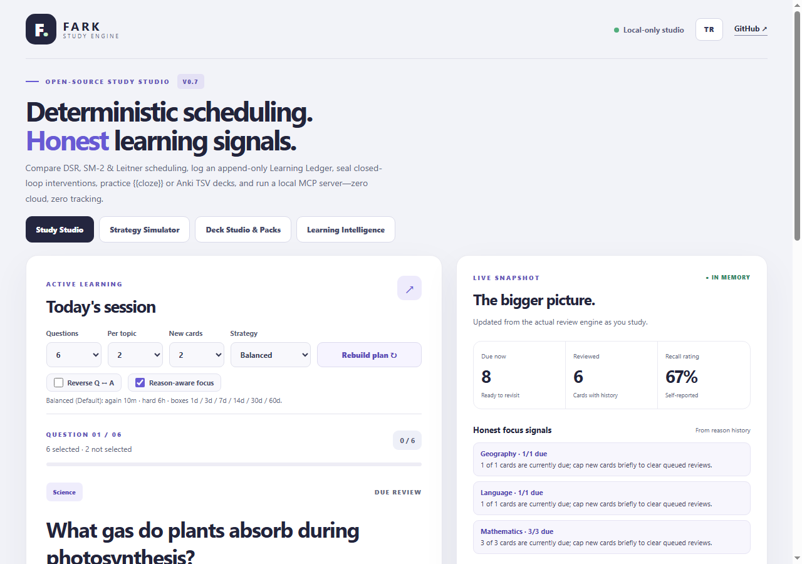

> [Read in English](README.md) · **Türkçe sürüm**

# FARK Study Engine 📚
### Öğrenmenin arkasındaki zekâ. / The thinking behind learning.

> **Her öğrenci farklı öğreniyorsa, neden hepsi aynı şekilde çalışmak zorunda?**
>
> *If every student learns differently, why should everyone study the same way?*

**FARK Study Engine**, açık kaynaklı, çevrimdışı ve sıfır maliyetli bir **Öğrenme Defteri (Ledger), Bilişsel Tanı ve Kapalı Döngü Müdahale Altyapısıdır**. Yalnızca başka bir SM-2 tekrar uygulaması üretmek yerine; öğrencinin **ne zaman neyi çalıştığını, hatanın dikkatsizlik mi kavram yanılgısı mı olduğunu, hangi önkoşulun tıkandığını ve verilen önerinin sonrasında işe yarayıp yaramadığını** ölçülebilir biçimde ortaya koyar.

> **Mimari Manifesto & Kıyaslama Raporu:** [Neden FARK Var? Açık Öğrenme Altyapısı (v0.7.0)](docs/open-learning-architecture.md) · `npm run demo:english` · `node scripts/benchmark-learning.mjs`

**v0.7.0 yenilikleri:** eklemeli olay defteri (`./ledger`), FSRS tarzı DSR bellek modeli & Brier kalibrasyonu (`./memory`), dış CSV/JSONL akışı tekrar oynatma ve **0 TL kişisel bellek kalibrasyonu** (`./calibrate`), **İngilizce Ustalık (A2→B2)** önkoşul müfredat paketi (`--pack english`, `npm run demo:english`), 13 araçlı sıfır bağımlılıklı MCP sunucusu (`./mcp`), `fark replay` / `fark calibrate` CLI komutları ve İnteraktif Stüdyo'da isteğe bağlı yerel kayıt + etkileşimli önkoşul grafiği düzenleyici — yine de sentetik ve gözlemsel verilerin klinik çalışma olmadığını açıkça belirterek.

> **Canlı İnteraktif Stüdyo (yalnızca tarayıcıda, sunucusuz):** [merttiramisu-art.github.io/fark-study-engine](https://merttiramisu-art.github.io/fark-study-engine/)



---

## Şu anda neler çalışıyor? / What's available today?

Sıfır harici bağımlılıklı, çevrimdışı kullanılabilen küçük bir JavaScript modülü:

- **Öğrenme kartı oluşturma:** konu, özgün soru, yanıt ve kimlikle kart tanımlama
- **Şeffaf tekrar zamanlaması:** `again`, `hard`, `good`, `easy` yanıtlarına göre bir sonraki tekrar tarihini hesaplama
- **Hataları öne çıkarma:** tekrar zamanı gelmiş kartları, hata geçmişini dikkate alarak sıralama
- **Dürüst ilerleme özeti:** yeni, çalışılmış, tekrar zamanı gelmiş kartlar ve gerçekten ölçülebilen yanıt istatistikleri
- **Öngörülebilir davranış:** aynı girdi ve tarihle aynı sonucu veren, değiştirilebilir yerel veri nesneleri

**Önemli sınırlar:** Verileri diske kaydetmez, buluta göndermez, hesap açtırmaz, öğrenmeyi bilimsel olarak kesin ölçtüğünü iddia etmez. Kalıcılık, kullanıcı arayüzü ve gerçek öğrenme etkililiği değerlendirmesi bu sürümde yoktur.

## Hemen dene / Quick start

**Node.js 20+** yeterli. API anahtarı, abonelik, paket kurulumu veya ücretli servis gerekmez.

```bash
npm test
npm run demo
npm run demo:planner
npm run demo:web  # http://127.0.0.1:4173/examples/web/
```

```js
import {
  createCard,
  reviewCard,
  selectReviewQueue,
  getStudySummary
} from './src/index.js';

const now = '2026-11-13T12:00:00Z';
const card = createCard({
  id: 'math-01',
  topic: 'Matematik',
  question: '2 + 3 kaçtır?',
  answer: '5'
});

const reviewed = reviewCard(card, 'good', now);
console.log(reviewed.dueAt); // 2026-11-14T12:00:00.000Z
console.log(selectReviewQueue([reviewed], '2026-11-14T12:00:00Z'));
console.log(getStudySummary([reviewed], now));
```

Tekrar aralıklarının nasıl belirlendiği [algoritma belgesinde](docs/algorithm.md) açıkça anlatılır. Kullanılan kurallar **deneme amaçlı sezgisel kurallardır**; kanıtlanmış kişisel öğrenme tahminleri değildir.


### v0.7.0 — Kişisel Bellek Kalibrasyonu (`./calibrate`), İngilizce (A2→B2) & Stüdyo İyileştirmeleri

- **Dış Olay Akışı Tekrar Oynatma ve 0 TL Kişisel Bellek Kalibrasyonu (`./calibrate`):** `parseReviewLogCsv`, `parseReviewLogJsonl`, `replayReviewStream` ve L2-düzenlemeli `fitLearnerParameters` fonksiyonları mevcut CSV/JSONL çalışma loglarını `balanced`, `sm2` ve `dsr` üzerinden kıyaslar; kronolojik %70/%30 önek-uyum / sonek-test kontrolüyle kişisel unutma parametrelerini (`initialStabilityScale`, `stabilityGainScale`) yerelde uyarlar.
- **İngilizce Ustalık (A2→B2) Paketi & 14 Günlük Kapalı Döngü Örneği (`npm run demo:english`):** `English: Core Verbs` → `English: Tenses` → `English: Conditionals & Passive` ve `English: Phrasal Verbs & Reading` konularını önkoşul grafiğiyle bağlar ve `examples/english-closed-loop.js` ile Day-7 tanı → müdahale mühürleme → Day-14 net iyileşme (`netUpliftVsControl: +0.75`) döngüsünü çalıştırır.
- **13 Araçlı MCP & `fark replay` / `fark calibrate` CLI:** `fark_replay_benchmark` ve `fark_calibrate_learner` MCP araçları eklendi; CLI `init` komutu `--pack english` paketini destekler.
- **Tarayıcı Stüdyosu (`examples/web/`, V0.7):** varsayılan kapalı ve kapatınca veriyi anında temizleyen **"İlerlemeyi bu cihazda hatırla"** (`localStorage`) seçeneği, etkileşimli döngü-korumalı **Önkoşul kavram bağlantıları** formu ve tek tıkla **"Unutma hızımı kalibre et (0 TL)"** düğmesi eklendi.

### v0.6.0 — Öğrenme Defteri, DSR Bellek, Kapalı Döngü Müdahale ve 4 Sekmeli Stüdyo

- **Eklemeli Öğrenme Defteri (`./ledger`):** Her çalışmayı geçen süre (`elapsedDays`), ön-tahmin (`predictedR`) ve kavram önkoşul grafiği (`linkConceptPrerequisites`) ile değişmez biçimde kaydeder; eski kart destelerini sahte tarih uydurmadan içeri alır.
- **DSR Bellek & Brier Kalibrasyonu (`./memory`, `dsr` stratejisi):** Güç yasası $R(t) = (1 + t/(9S))^{-1}$ ile bellek izini modeller, dikkatsizlik hatalarını (`attention`) kavram yanılgılarından (`misconception`) ayırarak SM-2 kolaylık cehenneminden kaçar ve tahmin tutarlılığını Brier skoru ile puanlar (`scripts/benchmark-learning.mjs`).
- **Önkoşul Tanısı ve Müdahale Doğrulama (`./diagnosis`):** Tıkanan önkoşulları yakalar (`diagnoseLearner`), öneri mühürlendiğinde (`recordIntervention`) başlangıç ve kontrol konusu oranlarını dondurur, sonrasında gerçekten gelişim sağlayıp sağlamadığını (`evaluateIntervention`) hesaplar.
- **11 Araçlı Kapalı Döngü MCP Sunucusu (`./mcp`, `fark mcp`) ve `fark diagnose` CLI:** Claude gibi yapay zekâ istemcileri `fark_diagnose_learner`, `fark_log_review_event`, `fark_record_intervention` ve `fark_evaluate_interventions` ile uydurmadan, kanıtlı rehberlik sunar.
- **4 Sekmeli İnteraktif Stüdyo (`examples/web/`):** `Öğrenme Analitiği` sekmesi eklendi; canlı Brier kalibrasyonu, tek tıkla müdahale mühürleme, öncesi/sonrası etki farkları ve MCP Ledger JSON dışa/içe aktarımı desteklenir ([mimari manifesto](docs/open-learning-architecture.md), [öğrenme içgörüleri](docs/learning-insights.md), [taşınabilir desteler](docs/portable-decks.md), [oturum planı](docs/session-planner.md), [CSV ve CLI](docs/csv-and-cli.md), [stratejiler](docs/strategies-and-markdown.md), [interaktif laboratuvar](docs/interactive-lab.md), [mobil QA](docs/mobile-qa.md)).

## Nereye gitmek istiyoruz? / Roadmap

Bunlar **gelecek hedefleri**, bugün tamamlanmış özellikler değil:

1. **Hata analizi:** bilgi eksiği, kavram karışıklığı ve dikkatsizlik gibi hata nedenlerini öğrenciye veya öğretmene görünür kılmak
2. **Daha anlamlı tekrar:** tek tip aralıklar yerine, gerçek öğrenme verileriyle değerlendirilebilir tekrar stratejileri
3. **Konu bazlı ilerleme:** güçlü ve zayıf alanları, bilinmeyeni uydurmadan ölçmek
4. **Uyarlanabilir çalışma önerileri:** öğrencinin geçmiş performansından yararlanarak öneriler sunmak; sonuçlarını test etmek
5. **Taşınabilirlik ve erişilebilirlik:** veri içe/dışa aktarma, farklı diller ve basit erişilebilir örnek arayüzler

Bu hedefleri adım adım, testler ve açık teknik kararlarla geliştirmek istiyoruz. Eğitimle ilgili iddiaları kanıt olmadan ürün gerçeği gibi sunmayacağız.

## Açık kaynak yaklaşımımız / Open-source principles

- **Şeffaflık:** Kullanıcıya gösterilen ilerlemenin neye dayandığı anlaşılabilir olmalı
- **Gizlilik:** Örnek veri dışında gerçek öğrenci bilgileri, kimlik bilgileri veya özel proje dosyaları burada yayımlanmaz
- **Özgünlük:** Telifli yayın soruları, kitap içerikleri ve izinsiz materyaller paylaşılmaz
- **Bağımsızlık:** Çekirdek, ücretli API veya takip servisine bağlı değildir
- **Titizlik:** Çalışıyor görünmesi yeterli değil; davranışların test edilmesi önemli

## Katılmak ister misin? / Contributing

Projeye katkı yapmak için deneyimli bir geliştirici olman gerekmiyor. Bir hatayı tekrar üretmek, test önermek, dokümantasyonu iyileştirmek veya küçük bir özellik geliştirmek bile değerli olabilir.

Önce [katkı rehberini](CONTRIBUTING.md) inceleyebilirsin. Özellikle öğrenme bilimiyle ilgili fikirlerin test edilebilir ve sınırlılıkları açık olacak biçimde sunulmasını önemsiyoruz.

## Lisans / License

[MIT](LICENSE) — özgürce kullanılabilir ve geliştirilebilir.
