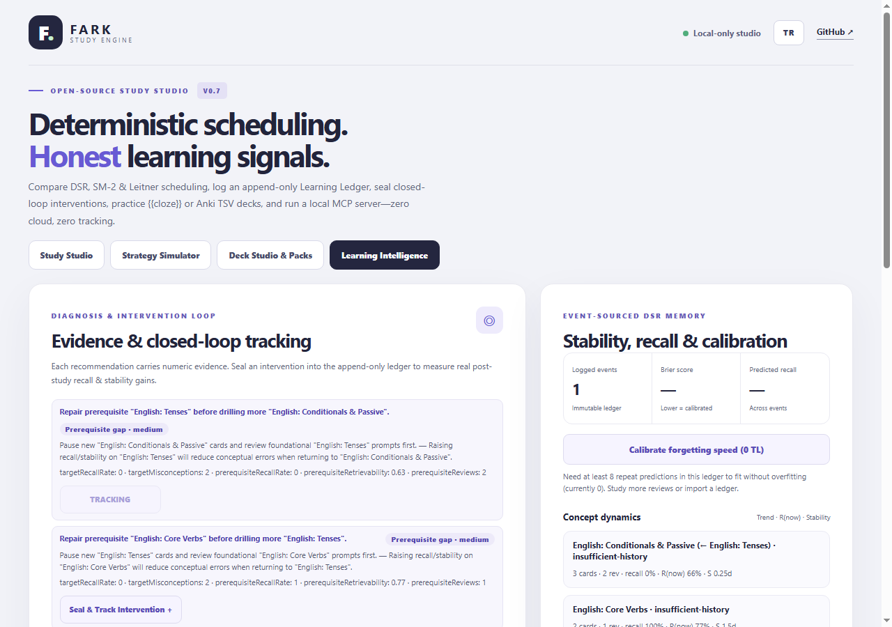

# Why FARK Exists: Open-Source Learning Infrastructure Architecture (v0.7.0)

> **Thesis:** Spaced-repetition apps do not fail learners because the world ran out of SM-2 clones. They fail because almost every flashcards tool throws away temporal chronology, conflates attention slips with conceptual misconceptions, ignores prerequisite dependencies, and lets AI "tutors" dispense advice with zero empirical audit of whether that advice actually improved retention.

**FARK Study Engine v0.7.0** establishes an open-source, offline-first, **zero-cost & zero-dependency** learning infrastructure built around four inspectable layers plus local stream replay & CPU parameter calibration: an append-only event ledger, a transparent DSR memory & calibration model (`./memory`, `./calibrate`), a prerequisite-aware closed-loop intervention engine, and a local Model Context Protocol (MCP) agent bridge.

---

## 1. Critique of Traditional Flashcard Clones

When designing v0.6.0, we audited the limitations of classic Leitner/SM-2 state machines (including FARK v0.1–v0.5's own card snapshots):

1. **Lossy counter collapse:** Mutable `reviews` and `lapses` totals erase *when* reviews happened, *how long* the elapsed interval actually was, and whether errors happened months ago or yesterday.
2. **"Ease Hell":** Fixed SM-2 ease penalties permanently trap recovering concepts in short repetition loops—especially when early errors were casual attention slips rather than conceptual gaps.
3. **Blind independence:** Flat decks assume every card is isolated. Drilling `Algorithms` or `Genetics` cards harder does not repair a broken prerequisite foundation in `Data Structures` or `Cell Biology`.
4. **Open-loop AI tutoring:** Connecting an LLM to a summary screen lets the model invent confident-sounding advice with zero baseline sealing and zero post-intervention uplift measurement.

---

## 2. Architectural Layers (`v0.7.0`)

### Layer 1: Append-Only Event-Sourced Learning Ledger (`./ledger`)
- **Format:** `fark-study-ledger` (version `1`), serializable via `exportLedger` / `importLedger` and strictly checked by `validateLedger`.
- **Immutable history:** Every study event records `elapsedDays`, pre-review `predictedR`, rating (`again|hard|good|easy`), optional self-reported `reason`, scheduled `intervalDays`, optional custom DSR `params`, and updated DSR state.
- **No fabricated timestamps:** When importing legacy `StudyCard[]` snapshots via `createLedger`, FARK preserves prior counters inside `importedSnapshot` without inventing fake historical timestamps.
- **Backward compatibility:** `projectCardsFromLedger` projects standard `StudyCard[]` decks at any timestamp so v0.1–v0.5 planners, CSV/TSV/Markdown exporters, and Web Components keep working unchanged.

### Layer 2: Transparent DSR Memory, Replay & 0 TL Personal Calibration (`./memory`, `./calibrate`, `dsr` strategy)
- **Power-law forgetting curve (`computeRetrievability`):**
  $$R(t) = \left(1 + \frac{t}{9S}\right)^{-1}$$
  At $t = S$, predicted recall equals $0.90$ (`DSR_DEFAULTS.defaultTargetRetention`). Optimal interval planning (`computeOptimalIntervalDays`) solves inversely for $R(t) = \text{targetRetention}$.
- **Spacing effect & mean-reverting difficulty (`updateDsrMemory`):** Delayed successful recalls ($R < 0.90$) earn stronger stability multipliers; difficulty mean-reverts rather than locking cards into Ease Hell. Optional `params = { initialStabilityScale, stabilityGainScale }` (`[0.25..3.0]`, default `1.0`) adapt predictions and spacing without changing core card schemas.
- **Slip vs misconception differentiation:** An `again` labeled `attention` avoids punitive difficulty escalation and sharp stability collapse compared to conceptual `misconception` lapses.
- **Honest prediction scoring (`evaluatePredictionCalibration`):** Scores every prediction where `predictedR != null` using **Brier score**, **log loss**, and 5 probability calibration bins (`0-20%` through `80-100%`), excluding unpredicted first reviews cleanly under `unscoredCount`.
- **External event-stream replay & local CPU calibration (`./calibrate`):** `parseReviewLogCsv`, `parseReviewLogJsonl`, `normalizeReviewEvents`, and `replayReviewStream` replay external logs or ledgers across `balanced`, `sm2`, and `dsr` identically; `fitLearnerParameters` uses L2-regularized deterministic grid search plus a strict non-leaky 70/30 chronological prefix-fit / suffix-holdout check (`events.length >= 20`) and refuses to fit below `minSamples` to avoid overfitting tiny histories.

### Layer 3: Prerequisite Concept DAG & Closed-Loop Interventions (`./diagnosis`)
- **Acyclic concept graph (`linkConceptPrerequisites`, `buildConceptNodesForCards`):** Models dependencies (such as `English: Core Verbs -> English: Tenses -> English: Conditionals & Passive`, `Mathematics -> Science`, `Cell Biology -> Genetics`) and rejects cycles statically.
- **Recovery vs legacy lapses (`computeConceptDynamics`):** Splits events into `recentSlice` vs `priorSlice` windows to report `improving`, `worsening`, `steady`, or `insufficient-data`.
- **Evidence-ranked recommendations (`diagnoseLearner`):** Surfaces numeric priority signals:
  1. `fix-prerequisite` (priority `100`): flags broken foundation concepts before wasting effort on child cards.
  2. `resolve-misconception` (`85`): detects concentrated conceptual mix-ups.
  3. `rescue-fading-memory` (`70`): surfaces multiple items decaying below 75% predicted `R`.
  4. `slow-down-reading` (`55`): distinguishes attention slips so intervals stay calm.
  5. `consolidate-backlog` (`40`): caps new card intake when due ratios exceed 60%.
- **Closed-loop intervention evaluation (`recordIntervention`, `evaluateIntervention`, `evaluateAllInterventions`):** Seals an action and hypothesis alongside frozen `baseline` target metrics *and* non-target-topic `controlRecallRate`, then computes post-intervention `recallDelta`, `misconceptionDelta`, `stabilityDeltaDays`, `netUpliftVsControl`, and observational verdicts (`insufficient-data`, `positive-signal`, `no-improvement-reassess`, `mixed-or-neutral`).

### Layer 4: Closed-Loop AI Agent Bridge via MCP (`./mcp`, `fark mcp`)
With **13 deterministic tools** over zero-dependency JSON-RPC 2.0 stdio, AI hosts (such as Claude Desktop or Claude Code) move from passive Q&A bots to auditable educational collaborators:

1. Call `fark_diagnose_learner` on a `fark-study-ledger` JSON payload to read prerequisite bottlenecks, DSR trends, and calibration metrics.
2. Benchmark strategies on past events via `fark_replay_benchmark` and locally fit forgetting-speed parameters via `fark_calibrate_learner`.
3. Guide targeted practice and record outcomes via `fark_log_review_event` (optionally passing calibrated `params`).
4. Commit a hypothesis to the ledger via `fark_record_intervention`.
5. After follow-up reviews accumulate, call `fark_evaluate_interventions` to verify whether recall, misconceptions, and stability actually improved relative to the frozen baseline and control topics.

---

## 3. Reference Case Study: 14-Day English Mastery Curriculum (`npm run demo:english`)

Run `node examples/english-closed-loop.js` (`npm run demo:english`) to trace a full offline English A2→B2 closed-loop episode (`English: Core Verbs` → `English: Tenses` → `English: Conditionals & Passive`, with non-target control topic `English: Phrasal Verbs & Reading`):

- **Day 7 MCP Diagnosis & Baseline Seal (`intv-11`):** Repeated `misconception` lapses on Conditionals & Passive while foundational Tenses struggled triggers `fix-prerequisite` (*Repair prerequisite "English: Tenses" before drilling more "English: Conditionals & Passive"*), freezing target baseline (`targetReviews=6`, `targetRecallRate=0`, `targetMisconceptionRate=1`, `meanStabilityDays=0.15`) alongside control performance (`controlReviews=4`, `controlRecallRate=0.75`).
- **Days 8–14 Remedial Study & Day 14 Evaluation:** Repairing tenses before returning to conditionals yields `positive-signal` (`recallDelta=+1`, `misconceptionDelta=-1`, `stabilityDeltaDays=+1.16`, `netUpliftVsControl=+0.75`).
- **Stream Replay & 0 TL Personal Calibration (9 scored reviews):** `dsr` lowers prediction error compared to heuristics (`dsr Brier=0.3808, LogLoss=1.0232` vs `sm2 Brier=0.4932, LogLoss=1.591` and `balanced Brier=0.4954, LogLoss=1.5975`), while regularized `fitLearnerParameters` reduces Brier by `-0.0373` (`initialStabilityScale=2, stabilityGainScale=1.05`) with explicit `<30` small-sample warning.

## 4. Empirical Cohort Validation (`scripts/benchmark-learning.mjs`)

Run `node scripts/benchmark-learning.mjs` locally at zero cost to inspect both synthetic forgetting cohorts (360-day horizon comparisons) and closed-loop intervention discrimination:

| Learner Profile | Strategy | Total Reviews | End Mean `R` | Reviews / 1% `R` | DSR Brier |
| --- | --- | --- | --- | --- | --- |
| Slip-prone (22% attention slips) | `balanced` | 422 | 98.3% | 4.29 | — |
| Slip-prone (22% attention slips) | `sm2` | 419 | 99.1% | 4.23 | — |
| Slip-prone (22% attention slips) | `dsr` | 261 | 96.3% | 2.71 | 0.191 |
| Steady (5% slips) | `balanced` | 286 | 98.4% | 2.91 | — |
| Steady (5% slips) | `sm2` | 258 | 98.1% | 2.63 | — |
| Steady (5% slips) | `dsr` | 200 | 95.6% | 2.09 | 0.0768 |
| Fragile memory (low initial `S`) | `balanced` | 402 | 98.1% | 4.1 | — |
| Fragile memory (low initial `S`) | `sm2` | 367 | 97.1% | 3.78 | — |
| Fragile memory (low initial `S`) | `dsr` | 261 | 92.4% | 2.82 | 0.1484 |

- **Closed-loop discrimination check (30 synthetic trials):** `truePositives=30/30, falsePositives=0/30`.

---

## 5. Scientific Honesty & Explicit Limitations

- **Simulation & small-sample fitting caveats:** Cohort benchmarks test synthetic power-law learners under explicit noise models; `fitLearnerParameters` enforces minimum repeat predictions (`minSamples`), warns below 30 scored predictions, and applies L2 regularization toward default `(1.0, 1.0)` plus chronological 70/30 holdout verification rather than overfitting small logs.
- **Observational quasi-control:** `evaluateIntervention` computes within-learner pre/post changes alongside non-target-topic comparisons. Small samples and shared fatigue mean its verdicts are diagnostic signals—never randomized clinical trials.
- **Self-reported recall:** Like every flashcard tool without external grading, memory ratings rely on honest learner input.

---

## Türkçe Özet

**FARK v0.7.0**, sıradan bir "tekrar uygulaması" olmaktan çıkıp açık kaynaklı bir **Öğrenme Defteri, Kişiselleştirilebilir Bellek Modeli ve Kapalı Döngü Müdahale Altyapısı** sunar:

1. **`./ledger` (Eklemeli Öğrenme Defteri):** Hataların ne zaman yapıldığını ve gerçek geçen aralıkları (`elapsedDays`, `predictedR`) silmez; eski desteleri sahte zaman damgası üretmeden okur.
2. **`./memory`, `./calibrate` & `dsr` stratejisi:** FSRS tarzı güç yasası $R(t) = (1 + t/(9S))^{-1}$ kullanır; dikkatsizlik (`attention`) hatalarını kavram karışıklığından (`misconception`) ayırarak SM-2 "kolaylık cehennemi" tuzağından kaçınır, dış CSV/JSONL çalışma kayıtlarını stratejiler arasında tekrar oynatır (`replayReviewStream`) ve **0 TL yerel CPU grid arama** + kronolojik doğrulama ile kişisel unutma hızını kalibre eder (`fitLearnerParameters`).
3. **`./diagnosis` & İngilizce A2→B2 Örnek Olayı (`npm run demo:english`):** `English: Core Verbs → English: Tenses → English: Conditionals & Passive` gibi önkoşul tıkanmalarını yakalar; mühürlenen müdahalelerin hedef ve kontrol konularına göre net iyileşme üretip üretmediğini ölçer (`evaluateIntervention`).
4. **`./mcp` (13 Araçlı Yapay Zekâ Köprüsü):** Claude gibi MCP istemcileri `fark_diagnose_learner`, `fark_replay_benchmark`, `fark_calibrate_learner`, `fark_log_review_event`, `fark_record_intervention` ve `fark_evaluate_interventions` araçlarıyla uydurma değil, doğrulanabilir pedagojik döngü kurar.
